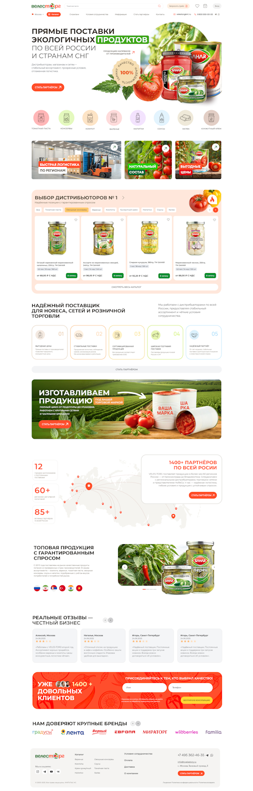
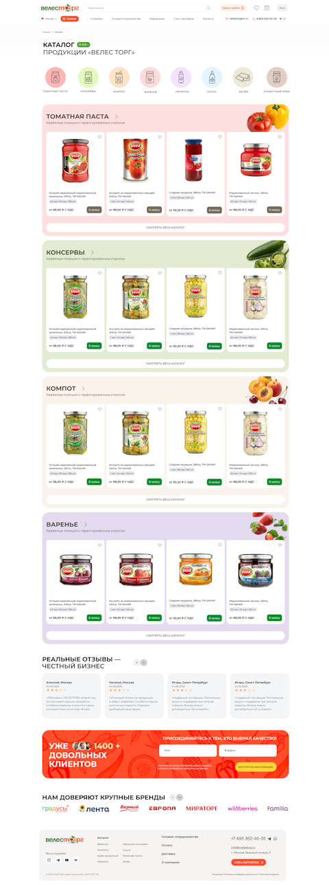

*** tcvelestorg-app-showcasse

# Оптовый интернет-магазин продукции хорека из Ирана

| Главная | Каталог | Карточка товара |
| -- | -- | -- |
|  |  |  |

## Задача: реализовать быстрый и динамичный оптовый интернет - магазин с возможностью масштабирования на регионы.

1. Стек TALL (Tailwind.css, Alpine.js, Livewire, Laravel).
2. Адаптивная верстка Laravel Blade и Tailwind.
3. Отзывчивый UI Alpine.js и Laravel Livewire.
4. Бекэнд Laravel (Eloquent, MySQL).

**Сайт был разработан полностью мной (кроме макета в Figma, над ним работал дизайнер).**

В карточке товара и корзине реализован выбор опции "Сборный палет" с алгоритмом формирования сборного палета (по умолчанию квант заказа - палет, при выборе опции кван заказа - количество товара в ряде).

*Ссылка на сайт [ТК Велесторг](https://tcvelestorg.ru)

Сайт может быть на обслуживании в связи с наполнением ассортиментом.
В этом сучае по требованию открою сайт для просмотра.

<u>Ссылка на репозиторий скрыта по требованию правообладателя.</u>